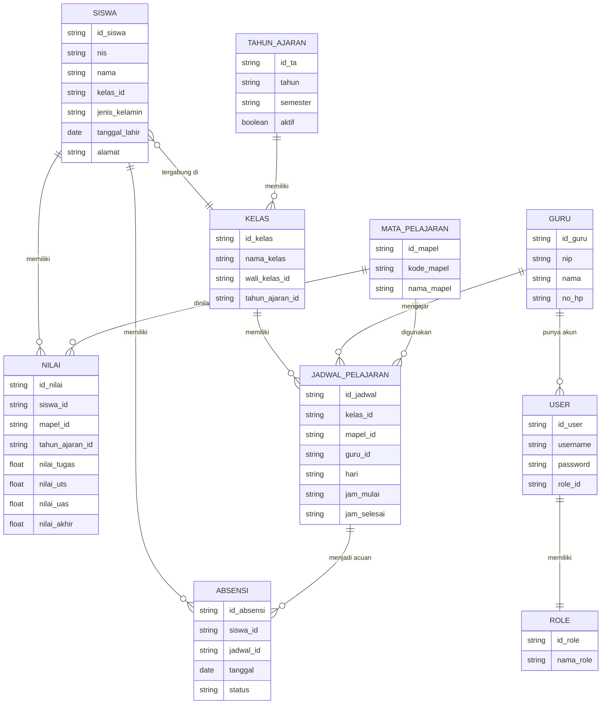
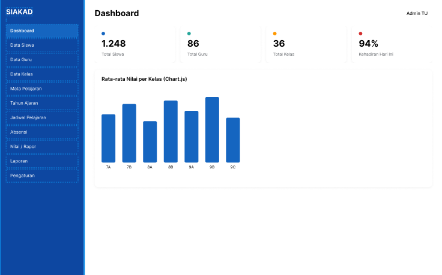
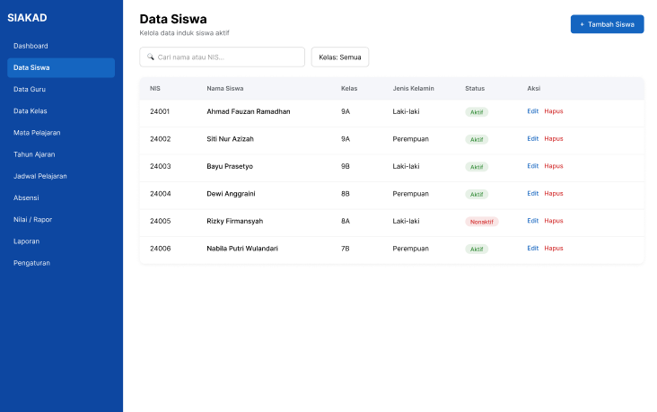

# PERANCANGAN.md
## Sistem Informasi Akademik Sekolah (SIAKAD) — Admin Panel
---

## 1. Deskripsi Singkat Sistem

SIAKAD (Sistem Informasi Akademik Sekolah) adalah sistem yang digunakan pihak sekolah (admin/tata usaha) untuk mengelola data akademik, meliputi data siswa, guru, kelas, mata pelajaran, jadwal, nilai/rapor, dan absensi.

Pada tahap proyek ini, aplikasi yang dibuat berfokus pada Admin Panel berbasis client-side. Data yang digunakan masih berupa mock data / Google Spreadsheet sebagai sumber data sementara, tanpa koneksi ke back-end atau database server.

---

## 2. Hirarki Menu (Sidebar / Navbar)

```
SIAKAD Admin Panel
│
├── 📊 Dashboard
│   ├── Ringkasan Jumlah Siswa, Guru, Kelas
│   ├── Grafik Kehadiran Mingguan
│   └── Grafik Rata-rata Nilai per Kelas
│
├── 🗂️ Data Master
│   ├── Data Siswa
│   │   ├── Daftar Siswa
│   │   ├── Tambah Siswa
│   │   └── Edit/Detail Siswa
│   ├── Data Guru
│   │   ├── Daftar Guru
│   │   ├── Tambah Guru
│   │   └── Edit/Detail Guru
│   ├── Data Kelas
│   │   ├── Daftar Kelas
│   │   └── Tambah/Edit Kelas
│   ├── Data Mata Pelajaran
│   │   ├── Daftar Mata Pelajaran
│   │   └── Tambah/Edit Mata Pelajaran
│   └── Data Tahun Ajaran
│       ├── Daftar Tahun Ajaran
│       └── Tambah/Edit Tahun Ajaran
│
├── 📚 Akademik
│   ├── Jadwal Pelajaran
│   │   ├── Lihat Jadwal per Kelas
│   │   └── Atur Jadwal (Guru, Mapel, Kelas, Jam)
│   ├── Absensi
│   │   ├── Input Absensi Harian
│   │   └── Rekap Absensi Siswa
│   ├── Nilai / Rapor
│   │   ├── Input Nilai per Mapel
│   │   ├── Lihat Nilai per Siswa
│   │   └── Cetak Rapor
│   └── Kenaikan Kelas
│       └── Proses Kenaikan Kelas (mock)
│
├── 📄 Laporan
│   ├── Laporan Akademik (Rata-rata Nilai, Ranking)
│   ├── Laporan Kehadiran
│   └── Cetak Laporan (Print View)
│
└── ⚙️ Pengaturan
    ├── Manajemen User & Role (Admin, TU, Guru)
    ├── Profil Sekolah
    └── Ganti Password / Akun
```

---

## 3. Konsep ER-D Sederhana (Mermaid.js)



---

## 4. Rencana User Flow

1. Login → Dashboard.
2. Dashboard → pilih menu Data Master → kelola Siswa, Guru, Kelas, Mata Pelajaran, dan Tahun Ajaran.
3. Data Master tersedia → menu Akademik → atur Jadwal → input Absensi → input Nilai.
4. Data Nilai dan Absensi terkumpul → menu Laporan → lihat atau cetak laporan.
5. Admin dapat mengatur akses melalui Pengaturan → Manajemen User & Role.

---

## 5. Tema Visual UI yang Dipilih

**Tema: Material Design**

Alasan pemilihan:
- Cocok untuk Admin Panel dengan banyak data tabular seperti siswa, nilai, dan absensi.
- Komponen seperti tabel, card, form, button, dan navigation sesuai dengan kebutuhan SIAKAD.
- Sistem grid, spacing, dan hierarchy membantu membedakan informasi pada Dashboard, halaman data, dan form.
- Banyak library pendukung yang dapat digunakan untuk mempercepat proses implementasi pada tahap coding.

> Catatan: Tema dapat disesuaikan setelah eksplorasi referensi desain sebelum masuk ke tahap implementasi.

---

## 6. UI Wireframing & Design System

### 6.1 Konsep Wireframe

Wireframe dibuat dengan pendekatan Low-to-Mid Fidelity sesuai kebutuhan Milestone 1. Fokus wireframe adalah menentukan struktur layout, navigasi, posisi komponen, dan alur interaksi sebelum masuk ke implementasi.

Halaman utama yang dirancang:
- **Login** — form login pengguna.
- **Dashboard** — sidebar, topbar, stat cards, dan grafik ringkasan akademik.
- **Data Siswa** — search, filter, tabel siswa, dan tombol aksi.
- **Form Tambah/Edit Siswa** — form input data siswa.
- **Data Guru** — tabel dan aksi pengelolaan data guru.
- **Data Kelas** — tabel dan pengelolaan kelas.
- **Data Mata Pelajaran** — tabel dan pengelolaan mata pelajaran.
- **Jadwal Pelajaran** — tampilan jadwal berdasarkan kelas.
- **Absensi** — input dan rekap absensi.
- **Nilai/Rapor** — input serta tampilan nilai siswa.
- **Laporan** — ringkasan laporan akademik dan kehadiran.
- **Pengaturan** — user, role, dan profil sekolah.

### 6.2 Link Figma

🔗 **File Figma:**
https://www.figma.com/design/SKuuDrBWKha7jY8cv3sh5w/SIAKAD-Admin-Panel---Design-System?node-id=1-3&t=Ibts94lppQWJx7Jz-1

Isi desain Figma digunakan sebagai acuan visual untuk implementasi antarmuka SIAKAD. File ini sudah memuat Design System (color palette, typography, komponen reusable) serta high-fidelity design untuk halaman Dashboard dan Data Siswa; halaman lainnya (Login, Form, Data Guru, Data Kelas, dst.) menyusul mengikuti struktur dan komponen yang sama.

**Screenshot Dashboard:**



**Screenshot Data Siswa:**



### 6.3 Komponen UI Utama

Design system/wireframe menggunakan komponen utama:
- Sidebar
- Topbar
- Button
- Input Form
- Select / Dropdown
- Search Bar
- Filter
- Table
- Card
- Badge / Status
- Modal / Dialog
- Pagination
- Chart

---
